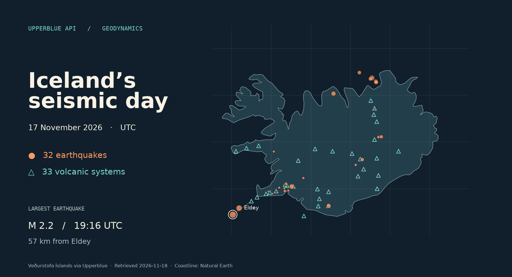
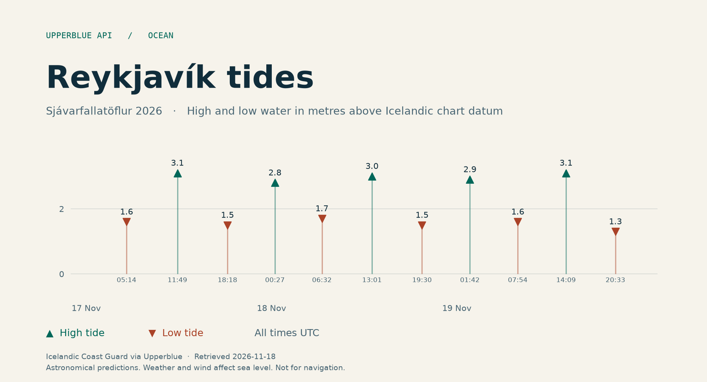

# Upperblue API demo

Learn the Upperblue REST API with two small Python programs. **Seismic day** overlays two datasets on a map. **Tide table** looks up a named site, then uses its ID to retrieve a time series. Start with the included data and switch to live requests with one flag.

| [Seismic day](seismic.py) | [Tide table](tides.py) |
| --- | --- |
| [](images/seismic-day.png) | [](images/tide-table.png) |
| Page through one day of earthquakes and find the volcanic system closest to the largest event. | Resolve Reykjavík in the Coast Guard tide-site catalogue and plot three days of predicted highs and lows. |

[Upperblue API guide](https://upperblue.com/en/api) · [Shared request code](api.py) · [Data credits](#data-and-licences)

## Run both demos

With Python 3.11 or newer:

```sh
git clone https://github.com/Upperblue-ehf/upperblue-api-demo.git
cd upperblue-api-demo
python3 -m venv .venv
source .venv/bin/activate
python -m pip install -r requirements.txt
python seismic.py
python tides.py
```

Open **seismic-day.png** and **tide-table.png** in the repository directory. After installation, these commands run offline and require no account. On Windows PowerShell, create the environment with `py -3.11 -m venv .venv` and activate it with `.\.venv\Scripts\Activate.ps1`.

## Use your API key

1. Get a **REST API key** through the [Upperblue API page](https://upperblue.com/en/api).
2. Copy the template with `cp .env.example .env` (PowerShell: `Copy-Item .env.example .env`). Open `.env` in your editor and set `UPPERBLUE_API_KEY` to your key. Git ignores this file. An existing environment variable takes precedence, so CI or a hosted application can supply the same setting through its secret store.
3. Pass a UTC date to request data from Upperblue. Choose a date within a published tide-table edition for the tide demo.

```sh
python seismic.py --date 2026-11-17 --output my-seismic-map.png
python tides.py --date 2026-11-17 --output my-tide-table.png
```

### Your first request

From Python in the repository directory, request the latest SeisComP earthquake. The helper reads your key and sends it in the `X-API-Key` header over HTTPS.

```python
from api import get

page = get("geodynamics/quakes", source_system="seiscomp", event_type="earthquake",
           sort="event_time:desc", limit=1)
for quake in page["data"]:
    print(quake["event_time"], quake["magnitude"])
```

| Demo | API requests | How the data fits together |
| --- | --- | --- |
| Seismic day | `/geodynamics/quakes` and `/geodynamics/volcanoes/geojson` | Apply UTC and geographic bounds, page through quake records, and measure distance to a catalogue point. Proximity alone cannot establish the cause of an earthquake. |
| Tide table | `/ocean/tides/sites/geojson` then `/ocean/tides/sites/{tideSiteId}/events` | Choose the site and source edition covering the three days. Request events from midnight UTC up to the exclusive end of the interval. Heights are metres above Icelandic chart datum. |

Each live request has a timeout. On **401**, check the REST key and any existing environment override. On **429**, wait for the server’s `Retry-After` interval when supplied. To change the visual or try a filter, edit the corresponding demo and run it again.

## Data and licences

- **Earthquakes and volcanic systems** come from Veðurstofa Íslands (Icelandic Meteorological Office). The sample covers 17 November 2026 UTC. Upperblue filtered the data, calculated the distance and drew the map. [IMO terms of use](https://www.vedur.is/um-vi/vefurinn/notkunarskilmalar/)
- **Tide predictions** come from Landhelgisgæsla Íslands (Icelandic Coast Guard), *Sjávarfallatöflur 2026*. The sample covers 17–19 November 2026 UTC. Upperblue selected and plotted the published high and low events and is responsible for that processing. Weather and wind can change actual sea level. This example is unsuitable for navigation. [Coast Guard tide tables](https://www.lhg.is/siglingaoryggi/sjavarfoll/)
- Both bundled API snapshots were retrieved on **18 November 2026**. The simplified coastline comes from the public-domain [Natural Earth 1:50m land dataset](https://www.naturalearthdata.com/downloads/50m-physical-vectors/50m-land/). The Python code uses the [MIT license](LICENSE).

## Contributing

Run `python -m unittest -v`, then run both demos offline before opening a pull request. If a figure changes, regenerate the corresponding README image with `--output images/seismic-day.png` or `--output images/tide-table.png`. CI tests and renders both samples without credentials. Include the command and Python version when reporting a problem.
